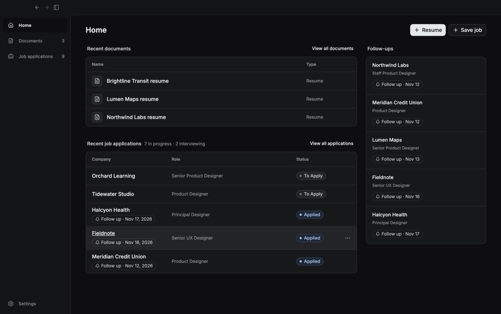

  

<h1 align="center">Lanzar</h1>

  <strong>Your resume and job search, in one place.</strong> 
  A desktop app for macOS and Windows. Keep one base resume, tailor a copy for each job,
  and track every application from saved to offer. Your files stay on your computer.

  <a href="https://github.com/luciovilla/lanzar-releases/releases/latest"><strong>Download the latest release</strong></a>
  ·
  <a href="https://www.luciovilla.com/lanzar">Website</a>
  ·
  <a href="https://github.com/luciovilla/lanzar-releases/releases">All releases</a>

  

## Everything else your search needs

- **Import your old resume.** Drop in a PDF and Lanzar pulls every section into an editable resume.
- **Check before you send.** Catches a page that runs long, dates out of order, and empty sections.
- **History for every document.** Each save is a version. Name the good ones and restore any of them.
- **Cover letters per job.** Write a letter next to the posting, attached to the application it belongs to.
- **Templates and fonts.** One- or two-column layouts and ten bundled fonts that work offline.
- **English y Español.** Use the app in either language. Each resume keeps its own language.

## Download

Get the installer for your system from the [latest release](https://github.com/luciovilla/lanzar-releases/releases/latest), or from the [download page](https://www.luciovilla.com/lanzar/download):

| System | File |
|---|---|
| macOS, Apple silicon (M1 and later) | `Lanzar-<version>-arm64.dmg` |
| macOS, Intel | `Lanzar-<version>.dmg` |
| Windows (x64 and Arm) | `Lanzar-Setup-<version>.exe` |

Once installed, Lanzar checks for new versions on its own and installs them when you restart.

## Your job search stays on your computer

Resumes, letters, and applications are files on your disk. There's no account to create and nothing to sync. Lanzar sends anonymous usage counts, never your documents, and you can turn them off in **Settings → Usage data**. See the [privacy policy](https://www.luciovilla.com/lanzar/privacy).

## About this repository

Lanzar's source code is private. This repository hosts the public builds and release notes, and the app's built-in updater reads new versions from its [releases](https://github.com/luciovilla/lanzar-releases/releases).
